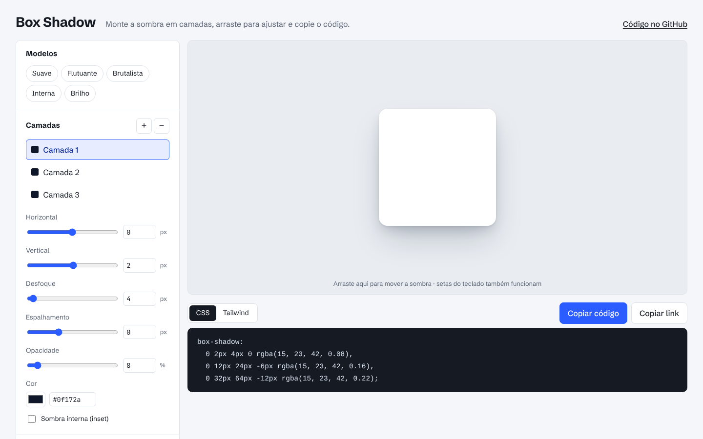
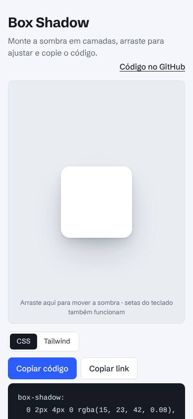

# Box Shadow

[](https://github.com/wagnerglongo/Box-shadow/actions/workflows/test.yml)

Editor visual de sombras CSS. Monte a sombra em várias camadas, arraste direto na prévia para ajustar e copie o código pronto em CSS ou em classe do Tailwind.

**🔗 No ar:** https://box-shadow.vercel.app

<p align="center">
  
  
</p>

## Funcionalidades

- **Várias camadas.** O `box-shadow` aceita sombras empilhadas, e é assim que se fazem sombras realistas. Dá para adicionar até 6 camadas, remover e escolher qual editar.
- **Arrastar na prévia.** Clique e arraste a área de visualização para mover a sombra da camada selecionada. Com o foco na prévia, as setas do teclado movem 1px (Shift + seta move 10px).
- **Modelos prontos:** Suave, Flutuante, Brutalista, Interna e Brilho.
- **Exportação para CSS e Tailwind**, com um clique para copiar.
- **Link compartilhável.** A configuração inteira fica na URL. Quem abrir o link vê a mesma sombra.
- **Controle deslizante e número sempre sincronizados**, nos dois sentidos.

## Decisões técnicas

| Tema | O que foi feito |
|---|---|
| Arquitetura | A lógica de transformar o estado em CSS (`src/shadow.js`) e de validar e serializar o estado (`src/state.js`) é feita de funções puras, sem DOM. A interface (`src/main.js`) só lê e escreve o estado e chama `render()`. |
| Interface gerada por dados | Os campos de cada camada vêm de uma lista de definições (rótulo, limites, unidade). Adicionar uma propriedade nova é uma linha. |
| Segurança | O estado que vem da URL é tratado como entrada não confiável: cores passam por regex, números são limitados aos intervalos, tipos são conferidos e a quantidade de camadas tem teto. Um link corrompido ou malicioso abre o estado padrão, sem erro. |
| Testes | 14 testes com o test runner nativo do Node (`node --test`), cobrindo conversão de cores, geração de CSS e Tailwind, ida e volta pela URL e entradas maliciosas. Rodam no GitHub Actions a cada push. |
| Acessibilidade | Camadas como `radiogroup` navegável por setas, abas com `aria-selected`, prévia operável pelo teclado, mensagens de cópia em `aria-live`, foco sempre visível. |
| Sem dependências | HTML, CSS e JavaScript (ES Modules) puros. Fontes hospedadas no projeto. |

## Estrutura

```
├── index.html
├── src/
│   ├── shadow.js     # estado → CSS / Tailwind (funções puras)
│   ├── state.js      # estado padrão, modelos, validação e URL
│   └── main.js       # interface, arrastar, teclado, cópia
├── tests/            # node --test
├── assets/
│   ├── css/styles.css
│   └── fonts/
├── docs/             # prints do README
└── .github/workflows/test.yml
```

## Rodando localmente

```bash
git clone https://github.com/wagnerglongo/Box-shadow.git
cd Box-shadow
npm run dev    # http://localhost:3000
npm test       # roda os testes (Node 20+)
```

---

Desenvolvido por [Wagner Longo](https://github.com/wagnerglongo).
